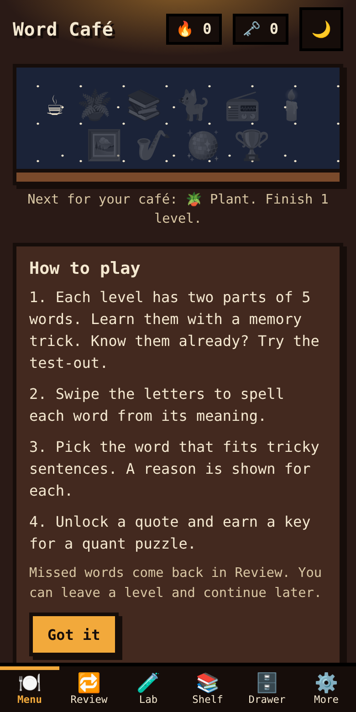
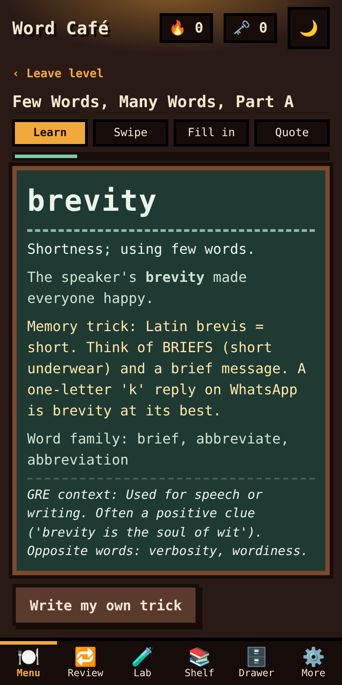
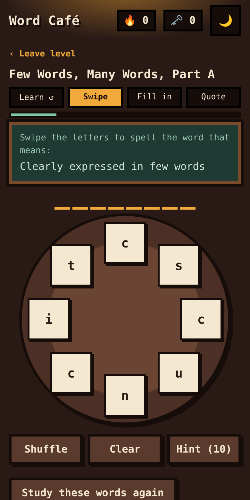
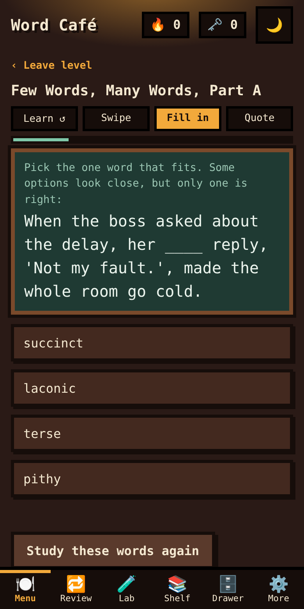
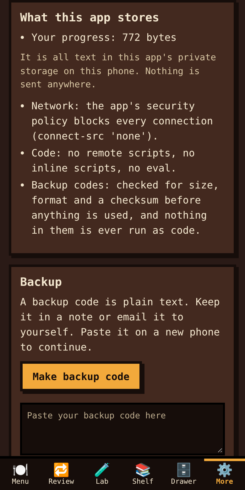
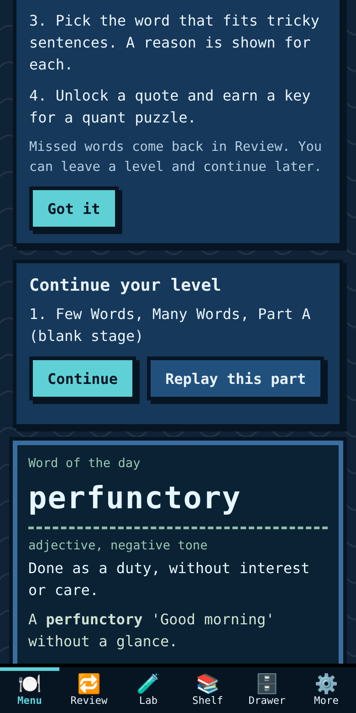

# Word Café

An offline GRE vocabulary game for Android. Swipe letters to spell a word from its meaning, fill in sentences, and unlock quotes and puzzles. **550 words, 55 levels, no account, no ads, no network.**

I built it to practise a rule I care about as a security and privacy engineer: **the safest data is data you never collect.** Everything stays on the phone, and the parts that read outside data (backup codes, saved storage) are tested against hostile input.

| | | |
|---|---|---|
|  |  |  |
|  |  |  |

## What it does
- **Learn, Swipe, Fill in, Quote** for every part of a level, with spaced review, a 10-word sprint, a word lab, reading passages, Sentence Equivalence, Text Completion and quant puzzles.
- **Study again and Replay**: a player who forgets a word can go back to the learn cards and return to the same word, or replay a part with fresh meaning wording and new hints.
- **8 themes**, readable on all of them (contrast checked), 48 px touch targets, and a wheel that works with a screen reader's double tap.
- **Backup codes** you can paste on a new phone, with an undo.

## Engineering highlights
- **Safe saved progress.** Progress is stored by fixed ids with a format version, not by list position, so adding or moving content never shifts anyone's saves. Old saves upgrade once and a copy is kept. A test fails if an id is ever changed.
- **Hostile-input testing.** The backup code reader is tested with a decompression bomb (80 MB in 106 KB), prototype-pollution keys, wrong types, huge numbers, tampered checksums and stored-XSS text. See [docs/THREAT_MODEL.md](docs/THREAT_MODEL.md).
- **Strict Content Security Policy.** `default-src 'none'`, no inline scripts, no `eval`, `connect-src 'none'`. A browser test proves each one is blocked.
- **No runtime dependencies.** The web code is plain JavaScript (about 2,000 lines), with no framework and no `innerHTML`. Capacitor only wraps it as an Android app.
- **Failing safely.** A start-up guard and a screen-level guard show a recovery screen instead of a blank page. Damaged storage is kept as a copy, not thrown away.
- **Data quality checks.** `npm test` checks every word entry (550 words), that meanings in a group never repeat, that quiz answers are real game words, and that the version file matches `package.json`.
- **CI.** GitHub Actions runs the data checks, 38 app tests, 30 security tests and `npm audit` on every push, and Dependabot keeps packages current.

## Run it
```
npm install
npx playwright install chromium     # once, for the browser tests
npx http-server www                 # or: python3 -m http.server -d www  (then open the address it prints)
npm run test:all
```
To build the Android app, follow [docs/BUILD.md](docs/BUILD.md).

## Project map
```
www/            the app (index.html, app.js, style.css, data*.js, lab*.js, syn*.js, var*.js, extras*.js)
tests/          validate-data.js, ui.test.js, security.test.js, ids.lock.json
docs/           THREAT_MODEL.md, BUILD.md, privacy.html, screenshots/
scripts/        version and update helpers
.github/        CI and Dependabot
```

## Notes
- Word selection was informed by community-compiled GRE word lists. The meanings, sentences and memory tips were written for this project. Quotes are from works in the public domain.
- Not affiliated with or endorsed by ETS. GRE is a registered trademark of ETS.
- Code is under the MIT license (see `LICENSE`).
- Security issues: see [SECURITY.md](SECURITY.md).

Built by [Moditha Kolli](https://github.com/modithakolli).
